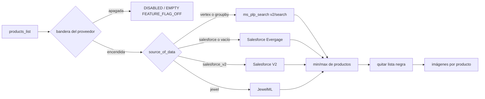

# En 30 segundos

- **CMS:** bloque `product_list` → referencia a una entrada `products_list` con `source_of_data`,
  `min_of_products`, `max_of_products` y la configuración de su proveedor.
- **Endpoints:** en línea dentro de `GET /blp|clp/**`, o `POST /blp/blocks/products-list` /
  `POST /clp/blocks/products-list` con el arreglo de bloques.
- **Sistemas:** ms_plp_search (Vertex), Salesforce Evergage, Salesforce Personalization (V2),
  JewelML y catalog-ingestion-service (lista negra).
- **Si falla:** el carrusel se degrada solo (`UNAVAILABLE`) o desaparece si no tiene productos; la
  página nunca falla por un carrusel.

# Cómo funciona



1. Composición: si el bloque cae dentro del offset (invitado: todos; logueado: ninguno) y no tiene una
   regla A/B activa, se resuelve en línea (`loadStrategy: EAGER`); si no, se anuncia como
   *placeholder* (`LAZY`) con `url` y `ms_params`.
2. Resolución: bandera del proveedor → regla A/B (`conditional_show_hide`) → precondiciones del
   proveedor → llamada con su circuit breaker → `min_of_products`/`max_of_products` → lista negra →
   límite de imágenes.
3. Un carrusel con menos productos que `min_of_products` se descarta (en la página desaparece; en el
   lote responde `EMPTY` + `BELOW_MIN_PRODUCTS`). La lista negra se aplica **después** del mínimo, como
   en web-bff.

# Implementación

## En el CMS

| `source_of_data` | Lo que lee del bloque | Notas |
|---|---|---|
| `vertex` | `products_data.category`, `max_of_products` | Sin categoría no se llama (`MISSING_CATEGORY`) |
| `groupby` | Igual que `vertex` | Alias de Vertex, como web-bff hacía en page-blp/clp |
| `salesforce` (o vacío) | `salesforce_carousel`, `salesforce_category_id` | Requiere `x-sf-user-id` + cookie `SessionId`; para invitado se descarta |
| `salesforce_v2` | `salesforce_v2_config` (`model`, `requires_*`) | Identidad por `x-sf-user-id` / `x-sf-device-id` |
| `jewel` | `jewel_model_config` | Identidad por `x-jml-user-id` / `x-jml-device-id` |
| otro (`lob`, `recently_viewed`) | — | Se sirve como contenido estático (`BLOCK_NO_RESOLVER`) |

## El endpoint en lote

`POST /blp/blocks/products-list` (o `/clp/...`) con el arreglo de bloques que la página anunció
(máximo 50). Cada elemento puede ser el bloque completo o solo su `ms_params`.

```json collapse title="Respuesta"
{
  "blocks": [
    { "blockId": "blt6325518c968643cd", "status": "AVAILABLE",
      "content": { "blockId": "blt6325518c968643cd", "products": [ { "productId": "1190634149" } ] } },
    { "blockId": "blt55d3e3dd19e0005f", "status": "EMPTY", "reason": "MISSING_USER_IDENTITY" }
  ]
}
```

| `status` | Qué hacer en el frontend |
|---|---|
| `AVAILABLE` | Pintar `content` |
| `EMPTY` | Quitar el bloque; **no** reintentar (`reason` dice por qué) |
| `UNAVAILABLE` | Pintar el `fallback` y reintentar después (`UPSTREAM_FAILED`, `CIRCUIT_BREAKER_OPEN`) |

`Cache-Control: public, max-age=<PRODUCTS_LIST_CACHE_TTL>` solo si todos los bloques son
independientes de la sesión (Vertex, Jewel sin identidad); si no, `no-store`.

## Lista negra

- Fuente: `GET {BLACKLIST_BASE_URL}/catalog-ingestion-service/v1/blacklist/{site}?limit=-1` →
  `{ "products": [...] }`, con `site` = nombre del enum `BrandSite` (`LP` → `LIVERPOOL`).
- Se lee una vez por sitio cada 10 min y se comparte entre todos los carruseles. **Falla abierta**: si
  no se puede leer, los carruseles salen sin filtrar y se registra `RESTRICTED_PRODUCTS_UNAVAILABLE`.
- Se aplica en `ProductsListUseCases`, así el carrusel en línea y el del lote filtran igual
  ([ADR-004](../reference/adrs.md#adr-004)).

# Configuración

| Clave | Dónde vive | Valor por defecto | Efecto |
|---|---|---|---|
| `FF_VERTEX` | env / banderas por marca | `true` | Carruseles `vertex` y `groupby` |
| `FF_PRODUCTS_LIST_SALESFORCE` | env / banderas por marca | `true` | Carruseles `salesforce` y sin fuente |
| `FF_PRODUCTS_LIST_SALESFORCE_V2` | env / banderas por marca | `true` | Carruseles `salesforce_v2` |
| `FF_JEWEL` | env / banderas por marca | `true` | Carruseles `jewel` |
| `FF_CONDITIONAL_SHOW_HIDE` | env / banderas por marca | `false` | Respeta las reglas A/B `conditional_show_hide` |
| `FF_CAROUSEL_RESTRICTED_PRODUCTS` | env / banderas por marca | `true` | Quita la lista negra |
| `VERTEX_BASE_URL` / `VERTEX_SEARCH_PATH` | env | `http://localhost:8084/api` / `/v2/search` | ms_plp_search |
| `VERTEX_USERNAME` / `VERTEX_PASSWORD` | Secret Manager | — | Basic hacia ms_plp_search |
| `SALESFORCE_CARROUSELS_URL`, `SALESFROCE_AUTH_*` | env / Secret Manager | — | Salesforce Evergage |
| `API_SALESFORCE_V2_URL` | env | — | Salesforce V2 |
| `API_JEWEL_URL`, `API_JEWEL_*_INTEGRATION_ID` | env | — | JewelML |
| `BLACKLIST_BASE_URL` / `BLACKLIST_PATH` / `BLACKLIST_CACHE_TTL` | env | site-d / `/catalog-ingestion-service/v1/blacklist` / `10m` | Lista negra |
| `PRODUCTS_LIST_CACHE_TTL` | env | `300` | `max-age` del lote cacheable |
| `PRODUCTS_LIST_MAX_IMAGES` | env / ajuste por marca | `1` | Imágenes por producto |

Precedencia de banderas: documento por marca en Mongo → `FF_OVERRIDE_JSON` → `FF_*` → `false`
(ver [Configuración](../plataforma/configuracion.md#banderas)).

# Soporte

> [!IMPORTANT]
> Todo lo de esta sección asume las variables de [Cómo usar los cURL](../funcionalidades.md#como-usar-los-curl).

## Dónde mirar en producción

- **Cloud Logging:** `jsonPayload.event` en `BLOCK_RESOLVED`, `BLOCK_SKIPPED`, `BLOCK_DROPPED`,
  `BLOCK_DEGRADED`, `UPSTREAM_NO_PRODUCTS`, `RESTRICTED_PRODUCTS_REMOVED`,
  `RESTRICTED_PRODUCTS_UNAVAILABLE`, con `jsonPayload.source` = el proveedor.
- **Circuit breakers:** `products-list-vertex`, `products-list-salesforce`,
  `products-list-salesforce-v2`, `products-list-jewel`, `carousel-blacklist`; cada cambio de estado
  deja una línea `CIRCUIT_BREAKER_STATE_CHANGED`.
- **Banderas por marca:** colección `ms_clp_blp_configuration`, documento `<MARCA>_<PERFIL>`
  (p. ej. `LP_PROD`).

## Síntomas y acciones

| Síntoma | Causa probable | Cómo confirmarlo | Acción |
|---|---|---|---|
| El carrusel no aparece en la página | Menos productos que `min_of_products`, audiencia distinta o proveedor apagado | `BLOCK_DROPPED`/`BLOCK_SKIPPED` con `reason` | Esperado si `reason` lo explica |
| Carrusel de Salesforce nunca sale para invitado | Requiere usuario | `reason: MISSING_USER_IDENTITY` | Esperado (igual que web-bff) |
| Aparece un producto bloqueado | Lista negra no se pudo leer o la bandera está apagada | `RESTRICTED_PRODUCTS_UNAVAILABLE`; `FF_CAROUSEL_RESTRICTED_PRODUCTS` | Revisar catalog-ingestion-service |
| `UNAVAILABLE` en todos los carruseles de un proveedor | Breaker abierto | `CIRCUIT_BREAKER_OPEN` con `breaker` | Revisar el proveedor; se recupera solo |

## cURLs de verificación

```bash
# Un carrusel Vertex por lote
curl -s "$MS_CLP_BLP_URL/blp/blocks/products-list" -H "x-brand-id: LP" -H "Content-Type: application/json" \
  -d '[{"uid":"blt6325518c968643cd","source_of_data":"vertex","products_data":{"category":"catst26617625"},"min_of_products":"6","max_of_products":"20"}]' \
  | jq '.blocks[] | {blockId, status, reason, n: (.content.products | length)}'

# Los carruseles que la página entrega lazy, tal cual, al endpoint en lote
curl -s "$MS_CLP_BLP_URL/blp/es-mx/tienda/esteelauder/catst26617625?eagerOffset=0" -H "x-brand-id: LP" \
  | jq '[.blocks[] | select(._content_type_uid=="products_list") | .ms_params]' \
  | curl -s "$MS_CLP_BLP_URL/blp/blocks/products-list" -H "x-brand-id: LP" -H "Content-Type: application/json" -d @- | jq
```

## Escalamiento

| Dependencia | Dueño | Qué adjuntar |
|---|---|---|
| ms_plp_search (Vertex) | Equipo de búsqueda | `categoryId`, `x-request-id`, línea `UPSTREAM_CALL_FAILED` |
| Salesforce / Salesforce V2 | Equipo de personalización | Acción o modelo, `x-request-id` |
| JewelML | Equipo de personalización | Modelo, marca |
| catalog-ingestion-service | Equipo de catálogo | Sitio, línea `RESTRICTED_PRODUCTS_UNAVAILABLE` |

# Referencias

- [ADR-004 — Lista negra desde catalog-ingestion](../reference/adrs.md#adr-004)
- Código: `landing/blocks/productslist/ProductsListUseCases.java`,
  `landing/blocks/productslist/adapters/*`, `landing/adapters/blacklist/RestrictedProductsAdapter.java`
