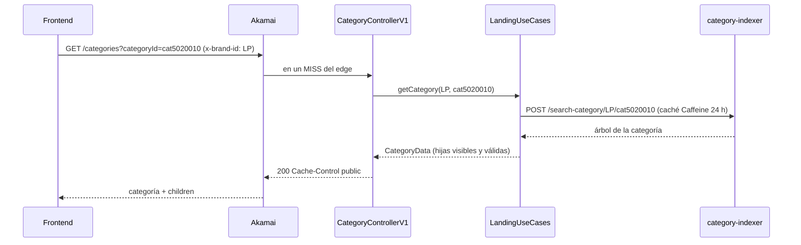

# En 30 segundos

- **Endpoint:** `GET /categories?categoryId=<id>`; la marca sale de `x-brand-id`.
- **Sistema:** solo category-tree-indexer (`POST /search-category/{marca}/{categoryId}`). No lee
  Contentstack.
- **Respuesta:** el objeto `categoryData` de las páginas BLP/CLP, en la raíz: la categoría, su
  `metadata` y `children[]` con `metadata.imageUrl`, `metadata.categoryImage`, `name`, `urlAddress`,
  `metadata.showpath` y `metadata.applyCLPRedirect` para navegar a cada hija.
- **Si falla:** categoría inexistente o indexador caído → 404 `CATEGORY_NOT_FOUND`, que el edge no
  guarda.

# Cómo funciona



1. El controlador toma la marca de `x-brand-id` (si no llega, `CMS_BRAND`) y el id del query param.
2. `LandingUseCases.getCategory` pide el árbol al indexador por `CategoryPort`, el mismo puerto (con
   el mismo breaker y la misma caché) que llena `categoryData` en las páginas.
3. `CategoryTreeMapper` arma la categoría: ids en mayúsculas, solo hijas `valid` y `visible`, valores
   por defecto heredados (`imageUrl: ""`, `groupType: "Not Specified"`, `rootIndex: 0`).
4. `CategoryDataMapper` la serializa con las mismas llaves y el mismo orden que `categoryData`, y la
   respuesta sale con `Cache-Control: public`.

# Implementación

## El endpoint

`GET /categories?categoryId=<id>`: `categoryId` es obligatorio y debe cumplir
`^[A-Za-z0-9_-]{1,64}$`, porque viaja en la ruta del indexador.

```json collapse title="Forma de la respuesta"
{
  "id": "CAT5020010",
  "name": "Ropa para hombre",
  "displayName": "Ropa para hombre",
  "urlAddress": "/tienda/ropa-para-hombre/cat5020010",
  "hidden": false,
  "ancestry": ["cat5020001"],
  "metadata": {
    "level": 2, "parent": "cat5020001", "title": "Ropa para hombre", "isBrand": false,
    "viewUrl": "/tienda/ropa-para-hombre/cat5020010", "imageUrl": "", "showpath": "CLP",
    "groupType": "NOT_SPECIFIED", "redirects": [], "rootIndex": 3, "categoryId": "CAT5020010",
    "parentTitle": "Hombre", "parentShowpath": "CLP", "categoryImage": "",
    "displayMegaMenu": true, "applyCLPRedirect": false, "...": "..."
  },
  "children": [
    {
      "id": "CAT5020011", "name": "Camisas", "displayName": "Camisas",
      "urlAddress": "/tienda/camisas/cat5020011", "hidden": false,
      "ancestry": ["cat5020001", "cat5020010"],
      "metadata": {
        "title": "Camisas", "viewUrl": "/tienda/camisas/cat5020011",
        "imageUrl": "https://ss201.liverpool.com.mx/xl/cat5020011.jpg",
        "categoryImage": "https://ss201.liverpool.com.mx/xl/cat5020011-cat.jpg",
        "showpath": "PLP", "parentShowpath": "CLP", "gpShowpath": "CLP",
        "applyCLPRedirect": false, "redirects": [], "...": "..."
      },
      "children": []
    }
  ],
  "breadcrumb": "home > Hombre > Ropa para hombre"
}
```

| Campo de cada hija | Para qué lo usa el frontend |
|---|---|
| `name` / `metadata.title` | Título de la tarjeta |
| `metadata.imageUrl`, `metadata.categoryImage` | Imagen de la tarjeta; `""` cuando el indexador no tiene (se pinta el placeholder) |
| `urlAddress` / `metadata.viewUrl` | A dónde navega la tarjeta |
| `metadata.showpath` | Tipo de página destino: `BLP`, `CLP` o `PLP` |
| `metadata.applyCLPRedirect` | La categoría redirige a su CLP |
| `metadata.parentShowpath`, `metadata.gpShowpath` | Tipo de página del padre y del abuelo |

## Reglas

- **Misma forma que `categoryData`:** la construyen `CategoryTreeMapper` y `CategoryDataMapper`, los
  mismos que usan las [páginas BLP y CLP](paginas-blp-clp.md#implementacion). Un cambio ahí cambia
  los dos endpoints.
- **Sin `redirectContent`:** ese dato viene de la entrada `category_redirect` de Contentstack y aquí
  no se lee. El redirect que aplica es el del indexador, `metadata.applyCLPRedirect`, en cada nodo.
- **Hijas:** solo las `valid` y `visible` (o las marcadas `status: 404` por el indexador), en el
  orden del indexador. `breadcrumb` solo aparece en la raíz.
- **No distingue "no existe" de "indexador caído":** los dos responden 404; la causa queda en el log
  `CATEGORY_UNAVAILABLE`.

## Códigos de respuesta

| Caso | Estado | `errorCode` |
|---|---|---|
| OK | 200 | — |
| Falta `categoryId` o tiene caracteres no permitidos | 400 | `VALIDATION_ERROR` |
| El indexador no devolvió la categoría (no existe, 4xx/5xx, timeout, breaker abierto) | 404 | `CATEGORY_NOT_FOUND` |
| Falta la credencial Basic | 401 | `UNAUTHORIZED` |

Errores en RFC 7807 (`application/problem+json`).

## Caché

- **Indexador (Caffeine, por instancia):** 24 h por marca + categoría en minúsculas, compartida con
  las páginas. Solo éxitos.
- **Edge:** todo 200 sale `Cache-Control: public` sin `max-age` (el TTL lo define la propiedad de
  Akamai). La respuesta no depende de sesión, cookies ni `x-is-logged-in`. Los errores conservan
  `no-cache, no-store` y nunca se guardan.
- **`Vary`:** `CorsVaryFilter` quita `Origin` y las cabeceras CORS de `Vary` en `/categories`, como
  en `/blp` y `/clp`; sin eso Akamai no guarda la respuesta.

> [!WARNING]
> La marca viaja en `x-brand-id`, no en la URL. La regla de Akamai para `/categories` debe incluir
> `x-brand-id` en la llave de caché, igual que `/blp` y `/clp`; si no, dos marcas compartirían la
> misma copia.

# Configuración

| Clave | Dónde vive | Valor por defecto | Efecto |
|---|---|---|---|
| `CATEGORY_INDEXER_URL` | env | `https://ogcp-apigke-site-d.liverpool.com.mx/category-indexer/v1` | Base del indexador (cambia por ambiente) |
| `CATEGORY_INDEXER_SEARCH_PATH` | env | `/search-category` | Ruta de búsqueda; se agregan marca e id |
| `CATEGORY_INDEXER_TIMEOUT` | env | `2s` | Timeout de lectura |
| `CATEGORY_INDEXER_CACHE_TTL` / `_CACHE_MAX_SIZE` | env | `24h` / `5000` | Caché Caffeine de categorías |
| `CMS_BRAND` | env | `LP` | Marca si no llega `x-brand-id` |

Todas las variables: [Configuración](../plataforma/configuracion.md).

# Soporte

> [!IMPORTANT]
> Todo lo de esta sección asume las variables de [Cómo usar los cURL](../funcionalidades.md#como-usar-los-curl).

## Dónde mirar en producción

- **Cloud Logging:** `resource.labels.service_name="dig-crp-clp-blp-service-prod"` y
  `jsonPayload.event="CATEGORY_SERVED"`: una línea INFO por petición que llega al origen, con
  `brand`, `categoryId` y `childrenCount`. Los HIT de Akamai no llegan al servicio.
- **404:** `jsonPayload.event="CATEGORY_UNAVAILABLE"` con el mismo `categoryId`; `detail` dice si
  el indexador respondió vacío, con error o si el breaker estaba abierto.
- **Circuit breaker:** `category-indexer` (compartido con las páginas).
- **Petición concreta:** `labels.requestId="<x-request-id>"`.

## Síntomas y acciones

| Síntoma | Causa probable | Cómo confirmarlo | Acción |
|---|---|---|---|
| 404 `CATEGORY_NOT_FOUND` en una categoría que existe | Indexador caído o breaker `category-indexer` abierto | `CATEGORY_UNAVAILABLE` con `detail` de timeout/5xx; `CIRCUIT_BREAKER_OPEN` | Revisar category-tree-indexer; el 404 no se cachea, se recupera solo |
| 404 en **todas** las categorías | `CATEGORY_INDEXER_URL` con la ruta equivocada | `detail` con `404 … [fault filter abort]` | La ruta de Apigee es `/category-indexer/v1` |
| Falta una subcategoría | El indexador la marca `visible: false` o `valid: false` | Consultar el indexador directo (cURL abajo) | Esperado; se corrige en el indexador |
| Tarjeta sin imagen | El indexador no tiene `imageUrl` para esa hija | `metadata.imageUrl: ""` en la respuesta | Esperado: el frontend pinta el placeholder |
| Un cambio del indexador no se ve | Caché Caffeine (24 h) o copia en Akamai | Antigüedad en Akamai; `CATEGORY_SERVED` ausente (HIT) | Esperar la expiración o purgar (`POST /ops/cache-purge`) |
| Respuesta de otra marca | La llave de Akamai no incluye `x-brand-id` | Mismo contenido con distinto `x-brand-id` | Corregir la regla de Akamai y purgar |
| 400 `VALIDATION_ERROR` | `categoryId` vacío o con `/`, `?`, `%`… | El `categoryId` enviado | Enviar el id tal como aparece en la URL de la tienda |

## cURLs de verificación

```bash
# Categoría con hijas: 200, Cache-Control public, imagen/título/navegación de cada hija
curl -s -i "$MS_CLP_BLP_URL/categories?categoryId=cat5020010" -H "x-brand-id: LP" -H "x-channel: WEB"

# Solo lo que pinta el carrusel
curl -s "$MS_CLP_BLP_URL/categories?categoryId=cat5020010" -H "x-brand-id: LP" -H "x-channel: WEB" \
  | jq '[.children[] | {name, img: .metadata.imageUrl, url: .urlAddress,
         showpath: .metadata.showpath, redirect: .metadata.applyCLPRedirect}]'

# Categoría inexistente: 404 CATEGORY_NOT_FOUND, sin Cache-Control public
curl -s -i "$MS_CLP_BLP_URL/categories?categoryId=cat00000000" -H "x-brand-id: LP" -H "x-channel: WEB"

# Lo que respondió el indexador (sin pasar por el servicio)
curl -s -X POST "https://ogcp-apigke-site-d.liverpool.com.mx/category-indexer/v1/search-category/LP/cat5020010" \
  | jq '{id, title, children: [.children[] | {id, title, visible, valid, imageUrl}]}'
```

## Escalamiento

| Dependencia | Dueño | Qué adjuntar |
|---|---|---|
| category-tree-indexer | Equipo de indexación | `categoryId`, marca, línea `CATEGORY_UNAVAILABLE`, respuesta directa del indexador |
| Akamai (regla de `/categories`) | Equipo de CDN | URL, `x-brand-id`, cabeceras `x-cache` / `x-check-cacheable` |

# Referencias

- [Páginas BLP y CLP](paginas-blp-clp.md): de donde sale la forma de `categoryData`.
- Código: `landing/adapters/rest/v1/CategoryControllerV1.java`, `landing/LandingUseCases.java`
  (`getCategory`), `landing/adapters/categoryindexer/CategoryTreeMapper.java`,
  `landing/adapters/rest/v1/CategoryDataMapper.java`, `shared/web/CorsVaryFilter.java`.
