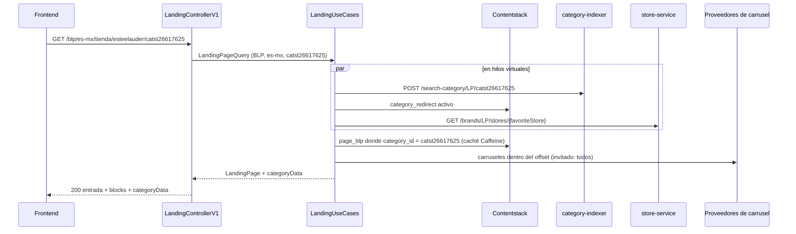

# En 30 segundos

- **CMS:** una entrada `page_blp` o `page_clp` por categoría, encontrada por `category_id` = último
  segmento de la URL (`/tienda/esteelauder/catst26617625` → `catst26617625`).
- **Endpoints:** `GET /blp/{locale}/**` y `GET /clp/{locale}/**`.
- **Sistemas:** Contentstack (página y redirect), category-tree-indexer (`categoryData`), store-service
  (tienda favorita para analítica) y los proveedores de los carruseles.
- **Si falla:** sin página en el CMS → 404; Contentstack caído → 502; cualquier otra dependencia caída
  → la página sale igual, sin esa parte.

# Cómo funciona



1. El controlador toma la marca de `x-brand-id`, la audiencia de `x-is-logged-in` y la tienda de la
   cookie `favoriteStore`. Nunca llama al servicio de autenticación.
2. `LandingUseCases` lanza en paralelo las lecturas de mejor esfuerzo (categoría, redirect, tienda) y
   lee la entrada del CMS en el hilo de la petición.
3. La composición recorre las secciones `top_content` → `blocks` → `bottom_content`, aplica las reglas
   de visibilidad y resuelve o anuncia cada carrusel según el offset (ver
   [Carruseles de productos](carruseles-de-productos.md)).
4. Se llenan los `customData` con `source: "bff"` (`index`, `selected_store.name`,
   `selected_store.code`) y se agrega `categoryData` si la entrada nombra su categoría.

# Implementación

## En el CMS

| Tipo de contenido | Campos que lee el servicio |
|---|---|
| `page_blp` | `category_id` (llave de búsqueda), `layout.blocks` o `blocks` (bloques principales), `header`/`footer` (opcionales: sobrescriben los globales), `events`, `seo`, el resto se devuelve tal cual. `apps_top_content`, `apps_products` y `apps_article` se **eliminan** de la respuesta. |
| `page_clp` | `category_id`, `top_content`, `bottom_content`, `category_parent_id`, `json_ld_data`, `header`/`footer`, `events`, `seo`. |
| `category_redirect` | `source_category_id` (en minúsculas) e `is_active: true`. |

La búsqueda se hace por `category_id`, nunca por `url`: el slug de la URL es texto libre
(`esteelauder` contra el autorado `estee-lauder`). El id se busca tal como llega y en minúsculas.
En stacks compartidos se añade el filtro `taxonomies.brand`.

## El endpoint

`GET /blp/{locale}/{path}` y `GET /clp/{locale}/{path}` — `locale` debe cumplir `^[a-z]{2}-[a-z]{2}$`.
`?eagerOffset=N` (≥ 0) sobrescribe cuántos bloques dinámicos se resuelven en línea.

La respuesta es la entrada de Contentstack con cada sección compuesta bajo su llave y
`categoryData` al final:

```json collapse title="Forma de la respuesta (BLP de invitado)"
{
  "uid": "blt0ff08f5fb7e51522",
  "locale": "es-mx",
  "category_id": "catst26617625",
  "url": "/tienda/estee-lauder/catst26617625",
  "events": [ { "name": "select_promotion", "customData": [ ... ] } ],
  "header": { "_content_type_uid": "header", "...": "..." },
  "footer": { "_content_type_uid": "footer", "menu_items": [ ... ] },
  "blocks": [
    { "_content_type_uid": "container", "uid": "...", "blocks": [ ... ] },
    { "_content_type_uid": "hero_banner_slider", "banners": [ ... ] },
    {
      "_content_type_uid": "products_list", "uid": "blt6325518c968643cd", "source_of_data": "vertex",
      "products": [ { "productId": "1190634149", "...": "..." } ],
      "loadStrategy": "EAGER", "status": "AVAILABLE", "httpMethod": "POST",
      "url": "/blp/blocks/products-list", "resolutionPath": "/blp/blocks/products-list", "ms_params": { }
    }
  ],
  "categoryData": {
    "id": "CATST26617625", "name": "Estee Lauder", "displayName": "Estee Lauder",
    "urlAddress": "/tienda/estee-lauder/catst26617625", "hidden": false, "ancestry": [],
    "metadata": { "level": 1, "showpath": "BLP", "isBrand": true, "redirects": [], "...": "..." },
    "children": [ { "id": "CATST56942247", "name": "Best Sellers", "...": "..." } ],
    "breadcrumb": "home > Estee Lauder"
  }
}
```

| Llave | Cuándo aparece |
|---|---|
| `blocks` | Si la entrada autora la sección principal (`layout` o `blocks`) |
| `top_content` / `bottom_content` | Si la entrada autora `top_layout`/`top_content` o `bottom_layout`/`bottom_content` |
| `categoryData` | Si la entrada tiene `category_id` y el indexador respondió |
| `categoryData.redirectContent` | Si hay un `category_redirect` activo: `{ "hasRedirect": true, ...entrada }` |
| `globalData` | **Nunca**: se toma de `GET /global-data` de ms-home ([ADR-002](../reference/adrs.md#adr-002)) |

## Reglas

- **Visibilidad por bloque:** `audience_filter` (`guest`/`logged`), `enable_on_web`/`enable_on_apps`
  según `x-channel`, `countdown` vencido o inactivo, `container_guest` para logueado. Un bloque que no
  pasa desaparece.
- **Footer:** los `menu_items` del `footer` de la página se filtran con la misma regla de audiencia.
- **Analítica:** el contador `index` es de toda la página (todas las secciones, luego los `events` de
  la entrada); `selected_store.*` se llena solo si la cookie resolvió una tienda.
- **Tipos desconocidos** se devuelven tal cual: nunca se pierde contenido.
- **CLP sin categoría en el indexador:** la página sale sin `categoryData` (web-bff respondía 404,
  [ADR-003](../reference/adrs.md#adr-003)).
- **BLP sin `category_id`:** 404, como en web-bff.

## Códigos de respuesta

| Caso | Estado | `errorCode` |
|---|---|---|
| OK | 200 | — |
| `locale` inválido, `eagerOffset` negativo, ruta sin categoría | 400 | `VALIDATION_ERROR` |
| Marca sin stack de Contentstack | 400 | `BRAND_NOT_SUPPORTED` |
| No hay página autorada para la categoría | 404 | `LANDING_PAGE_NOT_FOUND` |
| Contentstack caído, 5xx o sin credenciales | 502 | `CONTENT_SERVICE_UNAVAILABLE` |
| Falta la credencial Basic | 401 | `UNAUTHORIZED` |

Errores en RFC 7807 (`application/problem+json`).

## Caché

- **Caffeine (por instancia):** la entrada cruda por marca + locale + tipo + categoría, refresco a 30 s
  y expiración a 5 min. Solo las páginas encontradas se cachean.
- **Indexador:** 24 h por marca + categoría. **Tienda:** 24 h. Solo éxitos.
- **Edge (`Cache-Control`):** `public` para la página de invitado (`x-is-logged-in: false`) y para el
  esqueleto de logueado (offset 0 con cookie `SessionId`); `no-store, private` en cualquier otro caso y
  **siempre que venga la cookie `favoriteStore`**, porque la respuesta lleva la tienda de ese usuario
  ([ADR-005](../reference/adrs.md#adr-005)).

# Configuración

| Clave | Dónde vive | Valor por defecto | Efecto |
|---|---|---|---|
| `CMS_BRAND` | env | `LP` | Marca si no llega `x-brand-id` |
| `CMS_BLP_TYPE` / `CMS_CLP_TYPE` | env | `page_blp` / `page_clp` | Tipos de contenido de la página |
| `CMS_CATEGORY_REDIRECT_TYPE` | env | `category_redirect` | Tipo de contenido del redirect |
| `CMS_LANDING_CACHE_ENABLED` / `_REFRESH` / `_EXPIRE` / `_MAX_SIZE` | env | `true` / `30s` / `5m` / `2000` | Caché Caffeine de la entrada |
| `CONTENT_STACK_*` | Secret Manager | — | Credenciales por stack (LP, SB, MULTI1, MULTI2) |
| `LANDING_EAGER_OFFSET_GUEST` | env | `100` | Bloques dinámicos en línea para invitado |
| `LANDING_EAGER_OFFSET_LOGGED` | env | `0` | Bloques dinámicos en línea para logueado |
| `CATEGORY_INDEXER_URL` / `_TIMEOUT` / `_CACHE_TTL` | env | site-d / `2s` / `24h` | Indexador de categorías |
| `STORE_SERVICE_URL` / `_TIMEOUT` / `_CACHE_TTL` | env | site-d / `2s` / `24h` | Tienda favorita |

Todas las variables: [Configuración](../plataforma/configuracion.md).

# Soporte

> [!IMPORTANT]
> Todo lo de esta sección asume las variables de [Cómo usar los cURL](../funcionalidades.md#como-usar-los-curl).

## Dónde mirar en producción

- **Cloud Logging:** `resource.labels.service_name="dig-crp-clp-blp-service-prod"` y
  `jsonPayload.event="LANDING_COMPOSED"` — una línea INFO por página con `pageType`, `blocksTotal`,
  `blocksServed`, `dropsByReason` y `elapsedMs`. Para una petición concreta, filtra por
  `labels.requestId="<x-request-id>"` (el MDC viaja como etiquetas de la entrada).
- **Eventos de degradación:** `CATEGORY_UNAVAILABLE`, `CATEGORY_REDIRECT_UNAVAILABLE`,
  `FAVORITE_STORE_UNAVAILABLE`, `CMS_SOURCE_UNAVAILABLE`, `CIRCUIT_BREAKER_OPEN`,
  `CIRCUIT_BREAKER_STATE_CHANGED`.
- **Circuit breakers:** `contentstack-<MARCA>`, `category-indexer`, `store-service`.
- **Cabecera `x-data-origin`:** `ContentStack` (leída en vivo) o `caffeine` (caché).

## Síntomas y acciones

| Síntoma | Causa probable | Cómo confirmarlo | Acción |
|---|---|---|---|
| 404 en una BLP/CLP que "existe" | No hay entrada publicada con ese `category_id` en ese ambiente o marca | `LANDING_PAGE_NOT_FOUND` en la respuesta; buscar la entrada por `category_id` en Contentstack | Publicar la entrada o corregir su `category_id` (minúsculas) |
| Página sin `categoryData` | Indexador caído o categoría inexistente | `CATEGORY_UNAVAILABLE` con `categoryId` | Revisar category-tree-indexer; es esperado si la categoría no existe |
| Un cambio del CMS no se ve | Caché Caffeine (≤ 5 min) o edge | `x-data-origin: caffeine`; antigüedad en Akamai | Esperar la expiración o purgar (`POST /ops/cache-purge`) |
| Falta la tienda en la analítica | Sin cookie `favoriteStore` o store-service caído | `FAVORITE_STORE_UNAVAILABLE` (DEBUG) | Esperado sin cookie |
| 502 en todas las páginas de una marca | Contentstack caído o breaker `contentstack-<MARCA>` abierto | `CIRCUIT_BREAKER_OPEN`, `CMS_SOURCE_UNAVAILABLE` | Revisar estado de Contentstack y credenciales del stack |

## cURLs de verificación

```bash
# BLP de invitado: 200, blocks + categoryData, Cache-Control public
curl -s -i "$MS_CLP_BLP_URL/blp/es-mx/tienda/esteelauder/catst26617625" \
  -H "x-brand-id: LP" -H "x-channel: WEB" -H "x-is-logged-in: false"

# Con tienda favorita: selected_store en la analítica, Cache-Control no-store
curl -s "$MS_CLP_BLP_URL/blp/es-mx/tienda/esteelauder/catst26617625" \
  -H "x-brand-id: LP" -H "x-is-logged-in: false" -b "favoriteStore=$MS_CLP_BLP_STORE" \
  | jq '[.. | objects | select(.source? == "bff" and (.type|startswith("selected_store")))]'

# CLP: 404 LANDING_PAGE_NOT_FOUND si la categoría no tiene página autorada
curl -s -i "$MS_CLP_BLP_URL/clp/es-mx/tienda/belleza/cat5020010" -H "x-brand-id: LP"

# Solo el esqueleto (todos los carruseles lazy)
curl -s "$MS_CLP_BLP_URL/blp/es-mx/tienda/esteelauder/catst26617625?eagerOffset=0" \
  -H "x-brand-id: LP" | jq '[.blocks[] | {t: ._content_type_uid, s: .loadStrategy}]'
```

## Escalamiento

| Dependencia | Dueño | Qué adjuntar |
|---|---|---|
| Contentstack (entradas `page_blp`/`page_clp`) | Equipo CMS | `category_id`, marca, ambiente, `x-request-id` |
| category-tree-indexer | Equipo de indexación | `categoryId`, marca, línea `CATEGORY_UNAVAILABLE` |
| store-service | Equipo de tiendas | `storeId`, marca |

# Referencias

- [ADR-001 — Página por `category_id` directo en Contentstack](../reference/adrs.md#adr-001)
- [ADR-002 — Sin `globalData`](../reference/adrs.md#adr-002)
- [ADR-003 — `categoryData` es de mejor esfuerzo también en CLP](../reference/adrs.md#adr-003)
- [ADR-005 — Tienda favorita solo por cookie](../reference/adrs.md#adr-005)
- Código: `landing/LandingUseCases.java`, `landing/LandingCompositionService.java`,
  `landing/adapters/contentstack/LandingContentClient.java`,
  `landing/adapters/categoryindexer/CategoryTreeMapper.java`
