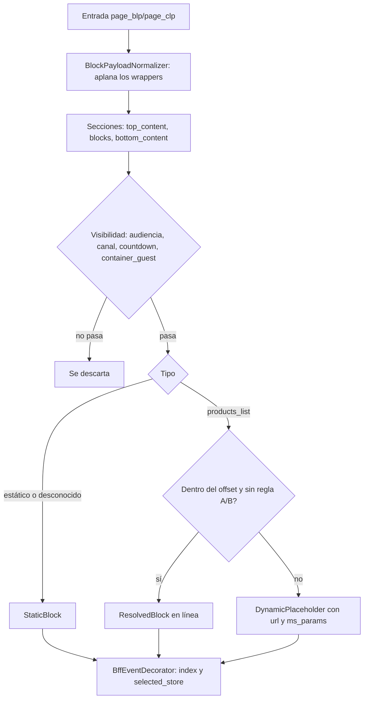

# Paquetes

```
com.liverpool.ms_clp_blp
├── landing/            slice: GET /blp/** y GET /clp/**
│   ├── ports/          LandingService (entrada) + ContentPort, CategoryPort, CategoryRedirectPort,
│   │                   FavoriteStorePort, RestrictedProductsPort, FeatureFlagPort… (salida)
│   ├── models/         records y tipos sellados: PageType, PageSection, LandingDefinition, LandingPage,
│   │                   LandingBlock (StaticBlock | DynamicPlaceholder | ResolvedBlock), CategoryData…
│   ├── adapters/       rest/v1, contentstack, cache, categoryindexer, store, blacklist, featureflag
│   ├── blocks/
│   │   └── productslist/   POST /blp|clp/blocks/products-list — Vertex, Salesforce, Salesforce V2, Jewel
│   ├── brandflags/     banderas por marca: webhook de Contentstack → Mongo → caché
│   ├── LandingUseCases           el único @Service del slice
│   ├── LandingCompositionService POJO puro, uno por PageType
│   └── LandingConfig             cableado de los POJOs y del catálogo de bloques por tipo de página
├── clients/            infraestructura: un cliente Feign + *FeignConfig + *Properties por sistema
│                       (contentstackdirect, categoryindexer, store, blacklist, vertex, salesforce,
│                       salesforcev2, jewel, akamai, mongo) + resilience + feign
└── shared/             transversal: errors (RFC 7807), session, web (seguridad, MDC, CORS),
                        logging (JSON para GCP), constants, cachepurge, cmspurgewebhook
```

# Reglas que el build verifica

`ArchitectureTest` (11 reglas ArchUnit) falla el build si:

- `shared` o `clients` dependen de `landing`;
- el núcleo de `landing` importa un `landing.blocks.*`, o un bloque importa `landing.adapters`;
- `brandflags` depende de un bloque;
- `ports/` o `models/` importan Spring o `jakarta.servlet`;
- un `@RestController` vive fuera de `adapters.rest`;
- una implementación de puerto, `BlockResolver` o `BlockParamsBuilder` vive fuera de su paquete;
- `productslist` lee `authenticated`/`isGuest` de la sesión (ese endpoint no recibe
  `x-is-logged-in` incorporado, así que siempre valdrían invitado).

# Composición de la página

La composición es el motor de la Home de ms-home aplicado a una entrada de landing:



- El offset cuenta **toda la página** en orden `top_content` → `blocks` → `bottom_content`.
- Todos los bloques en línea de todas las secciones se resuelven a la vez en hilos virtuales.
- Un bloque que falla se degrada a `UNAVAILABLE`; la página nunca falla por un bloque.

# Dependencias externas

| Sistema | Cliente | Breaker | Si falla |
|---|---|---|---|
| Contentstack (página, redirect, banderas) | `ContentStackClient` (platform-commons) | `contentstack-<MARCA>` | 502 (página) / sin redirect / banderas del YAML |
| category-tree-indexer | `CategoryIndexerClient` | `category-indexer` | Sin `categoryData` |
| store-service | `StoreClient` | `store-service` | Sin `selected_store` |
| catalog-ingestion (lista negra) | `BlacklistClient` | `carousel-blacklist` | Carruseles sin filtrar |
| ms_plp_search (Vertex) | `VertexClient` | `products-list-vertex` | Carrusel `UNAVAILABLE` |
| Salesforce / Salesforce V2 / Jewel | clientes de platform-commons | `products-list-*` | Carrusel `UNAVAILABLE` |
| Akamai Fast Purge | `AkamaiPurgeClient` | — | La purga responde el error |
| MongoDB (banderas) | `MongoTemplate` propio | — | Banderas del YAML |
